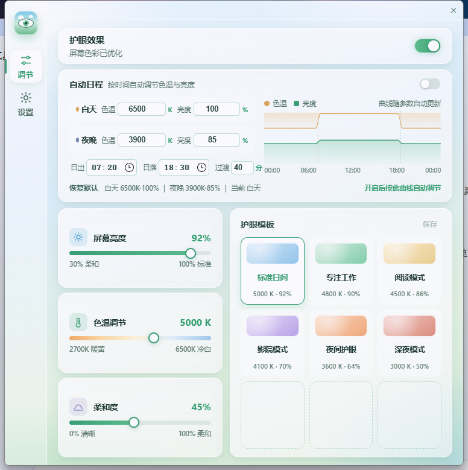
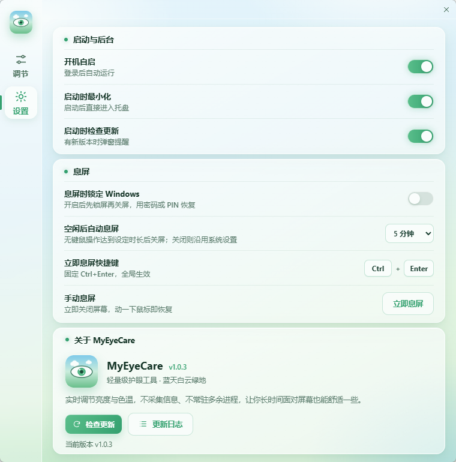

# MyEyeCare

MyEyeCare 是一个轻量级的 Windows 护眼小工具。它通过亮度、色温、柔和度与柔色遮罩调节屏幕观感，支持昼夜自动日程与空闲息屏，内置多套护眼模板，可开机自启并常驻托盘。基于 **Tauri 2 + Rust + 静态前端** 实现，不采集隐私信息。

- 项目名：`MyEyeCare`
- 应用标识：`com.yaoahos.myeyecare`
- 当前版本：`1.0.3`
- 支持平台：Windows 10 / 11（x64，需要 WebView2 运行时）
- 安装包：`MyEyeCare_1.0.3_x64-Setup.exe`（NSIS，简体中文界面）
- 绿色版：`MyEyeCare_1.0.3_x64-Portable.exe`（免安装单文件）
- 发布下载：[Releases](https://github.com/yaoahos/MyEyeCare/releases)

---

## 界面预览

**调节页**



**设置页**



---

## 一、软件介绍

MyEyeCare 面向长时间面对屏幕的用户，重点是把常用护眼操作放进一个足够小的窗口里，不引入账号、统计、云端同步和常驻服务。

设计目标：

1. **轻量**：单文件约 3.3 MB，后台只有应用自身进程。
2. **克制**：只有调节页和设置页，没有多余栏目。
3. **本地**：配置保存在安装目录内，不上传任何数据。
4. **即开即用**：安装版默认开启护眼效果、开机自启、启动最小化与启动检查更新。
5. **可靠**：关闭窗口强制驻留托盘，退出时恢复原始屏幕 gamma。

---

## 二、功能一览

**亮度与色温**

- 亮度 30%–100% 实时调节，基于 Win32 gamma ramp，多显示器同步生效
- 色温 2700K–6500K 实时调节，从暖黄平滑过渡到冷白
- gamma 由系统接管（如 HDR、远程桌面）时界面会提示失败，可改用柔色遮罩

**自动日程**

- 昼夜两态，白天与夜晚分别设置色温与亮度
- 日出、日落时间与过渡时长可调，曲线随参数自动更新
- 卡片实时显示当前时段与此刻生效值，可一键恢复默认

**柔和度**

- 0%–100% 可调，通过抬升黑位与压缩中间调降低对比度，文字不发灰

**柔色遮罩**

- 全屏半透明色罩，作为 gamma 调光的补充
- 6 种预设颜色：暖黄、琥珀、珊瑚、玫瑰、薰衣草、薄荷
- 强度 0%–100% 可调，鼠标穿透，不进入任务栏与 Alt-Tab

**护眼模板**

- 6 套内置模板：标准日间、专注工作、阅读模式、影院模式、夜间护眼、深夜模式
- 每套模板独立保存亮度、色温、柔和度、遮罩颜色与强度，切换时一并生效
- 3 个自定义模板位，支持命名保存与二次确认删除
- 当前配置与已有模板重复时禁止保存，避免产生冗余模板

**息屏**

- 空闲自动息屏：5 / 10 / 15 / 30 / 60 分钟可选，选「关闭」时沿用系统电源设置
- Ctrl+Enter 全局快捷键，在任意界面均可立即息屏
- 「立即息屏」按钮手动关屏，移动鼠标或按键盘即恢复
- 可选息屏时先锁定 Windows，解锁需输入密码或 PIN

**桌面体验**

- 自定义标题栏，拖动标题栏移动窗口
- 右上角关闭按钮只隐藏窗口到托盘，护眼效果继续生效
- 托盘左键单击或双击都展开主界面，右键菜单退出
- 开机自启、启动时最小化、启动时检查更新可独立开关
- 浅绿玻璃界面，蓝天白云绿地主题，两页均无滚动条

**更新**

- 启动时检查一次新版本（可关闭），发现更新时弹窗提醒
- 设置页「检查更新」可手动触发，发现新版本同样弹出更新窗口
- 支持软件内下载并启动安装，无需跳转浏览器
- 「更新日志」按钮打开 GitHub Releases

---

## 三、技术选型

| 层次 | 选型                       | 说明                                         |
| ---- | -------------------------- | -------------------------------------------- |
| 外壳 | Tauri 2                    | 原生窗口 + 系统 WebView2，不打包浏览器内核   |
| 后端 | Rust                       | 配置存储、gamma、遮罩、托盘、自启、息屏与外链校验 |
| 前端 | 原生 HTML / CSS / JS       | 无 npm 运行时依赖，页面直接嵌入二进制        |
| 调光 | Win32 `SetDeviceGammaRamp` | 使用 `CreateDCW` 获取每块屏幕的物理 DC       |
| 遮罩 | Win32 分层窗口 + GDI       | 独立线程绘制，鼠标穿透，不创建第二个 WebView |
| 息屏 | `SC_MONITORPOWER` + `RegisterHotKey` | 空闲时间取 `GetLastInputInfo`，快捷键在窗口线程注册 |
| 自启 | 注册表 Run 项              | 仅安装版使用，绿色版不写注册表               |
| 配置 | JSON                       | 保存到安装目录下的 `data\settings.json`      |

---

## 四、使用说明

**安装版**

1. 下载 `MyEyeCare_1.0.3_x64-Setup.exe`，双击安装。
2. 安装界面为简体中文，默认按当前用户安装。
3. 首次启动默认开启护眼效果、开机自启、启动最小化与启动检查更新，可在设置页调整。
4. 程序设置与运行数据保存在 `<安装目录>\data\`，不需要写入 `%APPDATA%`。
5. 卸载后程序文件会移除；如需彻底清理配置，手动删除残留的 `data\` 目录即可。

**绿色单文件版**

1. 下载 `MyEyeCare_1.0.3_x64-Portable.exe`，放到任意可写目录后双击运行。
2. 不写注册表开机自启，设置页隐藏对应开关。
3. 数据与运行文件放在 exe 同目录的 `data\`，删除 exe 与 `data\` 即完成清理。

**日常使用**

- 拖动标题栏移动窗口；点右上角关闭按钮隐藏到托盘。
- 选中某个护眼模板后，亮度、色温、柔和度与遮罩设置会一并应用。
- 想保存自己的配置，先调出与所有模板都不同的组合，「保存」按钮才会亮起。
- 柔色遮罩与 gamma 叠加，若觉得偏黄，建议从 10%–20% 强度开始微调。
- 按 Ctrl+Enter 可随时息屏，动一下鼠标即恢复；勾选「息屏时锁定 Windows」后会先锁屏再关屏。
- 需要完全恢复系统色彩时，关闭「护眼效果」总开关。

**数据位置**

```text
<安装目录>\
├── MyEyeCare.exe
└── data\
    ├── settings.json          配置与自定义模板
    └── WebView2 运行数据       由 Tauri 自动管理
```

> 安装目录必须可写。请使用默认的当前用户安装方式，不要安装到 `Program Files` 等需要管理员权限的位置。

---

## 五、项目构建

需要 Node.js 18+、Rust stable（MSVC 工具链）与 Visual Studio Build Tools。

```bash
npm install              # 安装 Tauri CLI，仅构建时需要
npm run dev              # 开发调试
npm run build            # 构建 NSIS 中文安装包
npm run build:portable   # 构建绿色单文件版
```

构建产物位于 `src-tauri/target/release/`，安装包在 `bundle/nsis/` 子目录。发布文件统一命名为：

```text
MyEyeCare_1.0.3_x64-Setup.exe      安装包，双击安装
MyEyeCare_1.0.3_x64-Portable.exe   绿色单文件版，双击即用
```

若构建时显式指定目标（`--target x86_64-pc-windows-msvc`），产物路径会多一层 `x86_64-pc-windows-msvc/`，文件名不变。

本机未预装 NSIS 时，Tauri CLI 会自动下载打包工具。

构建请在 PowerShell 或 cmd 中执行。Git Bash 自带 `/usr/bin/link`，会遮蔽 MSVC 的 `link.exe`，直接编译会报 `link: missing operand`。

---

## 六、兼容性与限制

- 只提供 Windows x64 版本；Tauri 可构建其它平台，但本项目未适配。
- 远程桌面、HDR 等由系统接管 gamma 的场景下，gamma 调光可能不生效，可使用柔色遮罩替代。
- 项目未购买代码签名证书，首次运行 Windows 可能提示「未知发布者」。
- 开机自启仅安装版提供；绿色版为避免注册表残留不支持该功能。
- 息屏依赖系统电源管理，个别显卡驱动或远程桌面环境下可能不响应；锁定功能需账户已设置密码或 PIN。
- 检查更新与软件内下载需要能访问 GitHub，网络受限时会提示失败，可改用发布页手动下载。
- 护眼效果依赖 gamma 与遮罩，不能替代显示器硬件校准。

---

## 七、隐私

MyEyeCare 不上传使用数据，不采集信息，不接入统计与广告 SDK。唯一的联网行为是：开启「启动时检查更新」或手动点击「检查更新」时，向 GitHub Releases API 发起一次只读请求。

---

## 八、版本记录

**2026/11/24 · 1.0.3**

- 息屏功能：空闲自动息屏、Ctrl+Enter 快捷键与手动息屏、息屏时锁定 Windows
- 修复自动日程开启时跳动、模板应用后未关闭、亮度无法调节
- 修复设置底栏偶发黑框
- 修复手动检查更新发现新版本时不弹出更新窗口
- 修复界面版本号未随更新显示，已是最新版本仍提示更新
- 托盘单击双击统一展开，关闭按钮补充悬停与提示
- 更新弹窗显示完整日志
- 优化调节页与设置页的排版与底部留白

**2026/11/20 · 1.0.2**

- 自动日程改为昼夜两态，可设白天与夜晚的色温亮度及过渡时长
- 新增柔和度调节，降低屏幕刺眼感
- 支持软件内更新，无需跳转浏览器
- 修复部分场景屏幕闪烁
- 修复从托盘恢复窗口时右上角关闭按钮残留高亮
- 字体放大加深，界面布局更舒展

**2026/11/18 · 1.0.1**

- 息屏唤醒或显示器重启后自动恢复护眼效果
- 分辨率 / DPI 变化后自动同步遮罩位置与置顶
- 更新弹窗显示真实更新日志，过长自动截断
- 启动最小化时检查到更新会唤起主窗口，让提醒可见

**2026/11/17 · 1.0.0**

- 屏幕亮度 30%–100% 与色温 2700K–6500K 实时调节
- 6 种预设颜色的全屏柔色遮罩，强度可调、鼠标穿透
- 6 套内置护眼模板与 3 个自定义模板位，切换时亮度、色温、遮罩一并生效
- 开机自启、启动最小化、启动检查更新与关闭驻留托盘
- 680×550 浅绿玻璃界面，双页面布局，无滚动条
- 安装版数据保存在安装目录 `data\`，绿色版不写注册表
- 简体中文 NSIS 安装包与免安装单文件版

更早版本见 [Releases](https://github.com/yaoahos/MyEyeCare/releases)。
